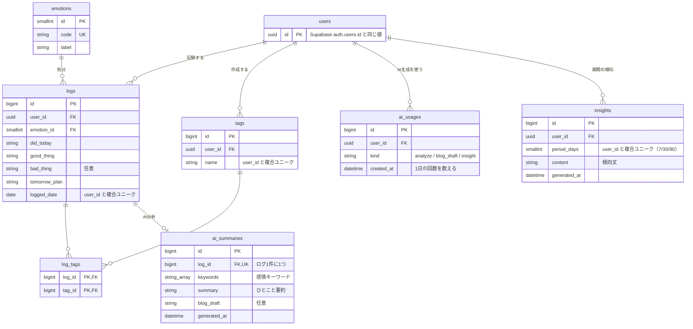

# エモログ（emolog）

ゲームのプレイ記録を「やったこと／良かったこと／モヤモヤしたこと／明日やること」の4項目と気分・タグで、1日1件ずつ残していく記録アプリです。
記録を続けると、連続記録日数・感情の内訳・気分の推移が自動で集計され、自分のコンディションの傾向を振り返れます。
AI（Gemini API）が記録ごとの感情キーワード・ひとこと要約・ブログ下書きと、期間ごとの気分の傾向をまとめます。

## デモ

- **URL**: https://emolog-three.vercel.app
- **デモアカウント**

  | 項目 | 値 |
  |---|---|
  | メールアドレス | `test@example.com` |
  | パスワード | `EmologTest2026` |

> デモアカウントには、約2週間分のサンプル記録（直近の記録にはAI分析・ブログ下書き、1週間のインサイト付き）が入っています。自由に追加・編集・削除して構いません。
> AI生成は1ユーザーにつき1日3回までです（デモアカウントは見に来た方全員で共有しています）。

## 要件定義

### 背景・目的

ゲームを長く遊んでいると、「今日は何をして、どう感じたか」は数日で忘れてしまいます。
エモログは、毎日の振り返りを **短い4項目＋気分** という決まった型で残すことで、記録のハードルを下げ、あとから感情の傾向を見返せるようにすることを目的としています。

### 想定ユーザー

- ゲームを日常的にプレイし、上達や気分の波を振り返りたい人
- 日記は続かないが、決まったフォーマットなら記録できる人

### ユーザーストーリー

- ユーザーとして、**今日の振り返りを1分以内に入力したい**。習慣として続けられるようにするため
- ユーザーとして、**気分を選んで記録したい**。あとから感情の傾向を見返すため
- ユーザーとして、**記録にタグを付けたい**。ゲームタイトルやコンテンツごとに振り返るため
- ユーザーとして、**書き忘れた日の記録をあとから追加したい**。記録の抜けを埋めるため
- ユーザーとして、**連続記録日数を見たい**。記録を続けるモチベーションにするため
- ユーザーとして、**期間ごとの感情の内訳や推移を見たい**。調子の良し悪しの傾向をつかむため
- ユーザーとして、**その日の記録をAIに要約してほしい**。自分の感情を言葉にして振り返るため
- ユーザーとして、**記録からブログの下書きを作りたい**。プレイ日記を発信する手間を減らすため

### 機能要件・非機能要件

| 区分 | 内容 |
|---|---|
| 記録 | 1ユーザーにつき1日1件（同じ日の重複登録は不可） |
| 入力 | 「やったこと」「良かったこと」「明日やること」は必須、「モヤモヤしたこと」は任意 |
| 認証 | ログインしたユーザーだけが自分の記録を閲覧・操作できる |
| バリデーション | クライアントとサーバーの両方で同じスキーマ（zod）を使って検証する |
| AI生成 | ボタンを押したときだけ生成し、結果はDBに保存して使い回す。1ユーザー1日3回まで（日本時間で日付が変わるとリセット） |
| レスポンシブ | スマホ（375px）〜PC（1440px）に対応する。モバイルファーストで実装する |

## 機能一覧

| 画面 | 機能 |
|---|---|
| 認証 | メールアドレス＋パスワードでの新規登録（確認メールあり）・ログイン |
| | Googleアカウントでのログイン（OAuth） |
| | ログアウト、未ログイン時のアクセス制限 |
| ホーム（`/`） | 連続記録日数・今月の記録件数・直近の気分の表示 |
| | 直近7日間の記録状況の表示 |
| | 最新のAIインサイト（期間の傾向）の表示 |
| | クイックアクション（一覧・分析・今日の記録のブログ下書きへ） |
| 記録する（`/post`） | 4項目＋気分＋タグで今日の記録を作成 |
| | タグの選択・その場での新規作成 |
| | 過去の日付の記録を追加（カレンダーから） |
| | 保存完了のトースト通知 |
| 一覧（`/logs`） | カレンダーで記録した日と気分を一覧表示 |
| | 記録の詳細表示（PCでは一覧と詳細を2ペインで同時に表示） |
| | 記録の編集・削除 |
| | 記録のテキストコピー・SNSシェア |
| | **AI分析**：感情キーワードとひとこと要約の生成（分析後にログを編集すると「結果が古い」と表示） |
| | **AIブログ下書き**：記録とAI分析をもとにブログ記事の下書きを生成・コピー |
| 分析（`/analytics`） | 集計期間の切り替え（1週間／1ヶ月／3ヶ月） |
| | 記録日数・多い感情・連続記録の表示 |
| | 感情の内訳・気分スコアの推移グラフ |
| | よく遊んだコンテンツ（期間内に多く付けたタグ） |
| | **AIインサイト**：期間の気分の傾向を文章で要約 |

## 使用技術

### フレームワーク・言語

| 技術 | バージョン | 用途 |
|---|---|---|
| [Next.js](https://nextjs.org/)（App Router） | 16.3 | フロントエンド・APIルート |
| [React](https://react.dev/) | 19.2 | UI |
| [TypeScript](https://www.typescriptlang.org/) | 5 | 型安全な開発 |

### 主なライブラリ

| ライブラリ | 用途 |
|---|---|
| [Tailwind CSS](https://tailwindcss.com/) v4 | スタイリング |
| [shadcn/ui](https://ui.shadcn.com/)（Base UI） | UIコンポーネント |
| [Prisma](https://www.prisma.io/) v7 | ORM（`@prisma/adapter-pg` によるドライバーアダプター方式） |
| [React Hook Form](https://react-hook-form.com/) | フォームの状態管理 |
| [Zod](https://zod.dev/) v4 | バリデーション（クライアント・サーバーで共通のスキーマ）、AIの出力の検証 |
| [Recharts](https://recharts.org/) | 分析画面のグラフ |
| [Sonner](https://sonner.emilkowal.ski/) | トースト通知 |
| [lucide-react](https://lucide.dev/) | アイコン |
| [@supabase/ssr](https://supabase.com/docs/guides/auth/server-side) | Next.js でのセッション管理（Cookie） |
| [@google/genai](https://github.com/googleapis/js-genai) | Gemini API の公式SDK |
| [Prettier](https://prettier.io/) / [ESLint](https://eslint.org/) | コードの整形・静的解析 |

### インフラ・外部サービス／API

| サービス | 用途 |
|---|---|
| [Supabase Auth](https://supabase.com/docs/guides/auth) | ユーザー認証（メール＋パスワード） |
| [Google OAuth 2.0](https://developers.google.com/identity/protocols/oauth2)（Supabase Auth経由） | Googleアカウントでのログイン |
| [Supabase Database](https://supabase.com/docs/guides/database)（PostgreSQL） | 記録・タグ・感情マスタ・AI生成結果の保存 |
| [Gemini API](https://ai.google.dev/gemini-api/docs)（`gemini-3.5-flash`・無料枠） | 感情キーワード・ひとこと要約・ブログ下書き・期間インサイトの生成 |
| [Vercel](https://vercel.com/) | ホスティング |

### AI機能の設計

- **呼び出しはサーバー側のみ**：APIキーは `GEMINI_API_KEY`（`NEXT_PUBLIC_` なし）で、Route Handler からだけ Gemini を呼ぶ
- **出力の検証**：キーワード・要約は JSON Schema（zod から生成）で形式を指定し、返ってきた JSON も zod で検証してから保存する
- **無料枠への配慮**：ボタンを押したときだけ生成し、結果を `ai_summaries`・`insights` に保存して使い回す。1ユーザー1日3回の上限を `ai_usages` で管理する
- **障害への備え**：混雑（503）は待ち時間を延ばしながら最大3回再試行し、応答が25秒（ブログは45秒）を超えたら中断してユーザーに知らせる
- **数字はコードで計算**：インサイトの件数・スコア平均・よく付けたタグはコードで集計し、AIには結果と各ログのひとこと要約だけを渡す（気分はスコアの数字ではなく「楽しい寄りの気分」などの言葉で渡す）

## ER図



## ローカルでの起動方法

```bash
# 1. 依存パッケージのインストール（postinstall で prisma generate も実行されます）
npm install

# 2. 環境変数の設定（.env.local を作成）
#   DATABASE_URL                          Supabase の接続文字列（pooler・ポート6543）
#   DIRECT_URL                            Supabase の接続文字列（直接接続・ポート5432。マイグレーション用）
#   SUPABASE_URL / SUPABASE_PUBLISHABLE_KEY
#   NEXT_PUBLIC_SUPABASE_URL / NEXT_PUBLIC_SUPABASE_PUBLISHABLE_KEY
#   GEMINI_API_KEY                        Google AI Studio で発行した Gemini API キー

# 3. マイグレーションと感情マスタの投入
npx prisma migrate deploy
npx prisma db seed

# 4. 開発サーバーの起動
npm run dev
```

[http://localhost:3000](http://localhost:3000) を開くとアプリが表示されます。

### その他のコマンド

| コマンド | 内容 |
|---|---|
| `npm run lint` | ESLint による静的解析 |
| `npm run format` / `npm run format:check` | Prettier による整形 / 整形済みかの確認 |
| `npm run seed:demo` | デモアカウント（`test@example.com`）のサンプル記録を入れ直す。`-- --ai` を付けると AI 分析・ブログ下書き・インサイトも生成する（事前に Supabase の管理画面でユーザーを作成しておく） |

> スキーマを変更して `prisma migrate dev` を実行したあとは、開発サーバーを再起動してください（Prisma Client を使い回しているため、再起動するまで新しいモデルが使えません）。

## 今後の予定

- 一覧画面の週ごと・月ごとの表示
- 記録の検索
- 分析画面のポジティブ率の表示
